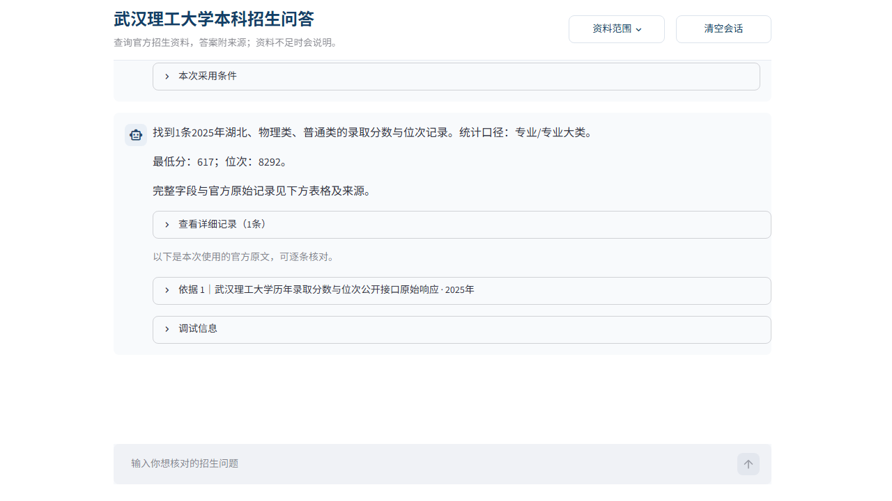

# 武汉理工大学本科招生问答原型

这是软件需求工程课程大作业中的本地可交互 RAG 原型。系统面向武汉理工大学本科招生咨询，支持录取数据、招生计划、选科与报考条件、专业和专业大类、收费及中外合作项目等查询，并在回答中保留资料年份和来源定位。



## 项目范围

- 资料年度：2024—2026 年。
- 资料来源：武汉理工大学官方本科招生网页及附件。
- 覆盖目标：全国招生省份、学校公布的招生专业及专业大类和相应选科条件。
- 运行方式：本地 Streamlit 页面。

## 目录说明

```text
app.py                  Streamlit 前端
whut_rag/               查询、检索、生成和回答检查代码
data/                   官方资料清单及导入配置
知识库官方资料/          本地原始资料目录（本仓库不包含原文件）
docs/prototype.png      原型运行截图
启动原型.ps1            Windows 启动脚本
```

## 本地运行

要求 Python 3.11，并建议使用 [uv](https://docs.astral.sh/uv/) 管理依赖。

```powershell
uv sync --frozen
.\启动原型.ps1
```

启动后访问：<http://127.0.0.1:8501/>

向量检索和需要生成模型的文字问答使用本机 Ollama：

- 向量模型：`bge-m3`
- 生成模型：`deepseek-r1:7b`

结构化录取、计划和收费查询使用已导入的本地数据记录，不由模型推算数值。

## 准备知识库

本发布目录不包含课程项目使用的官方原始资料、运行数据库和测试日志。请根据 `data/*.json` 中的官方网址自行取得资料，并按 `知识库官方资料/README.md` 放置文件，然后执行：

```powershell
uv run python -m whut_rag.cli index
uv run python -m whut_rag.cli import-structured
uv run python -m whut_rag.cli import-fees
uv run python -m whut_rag.cli import-eligibility
uv run python -m whut_rag.cli status
```

命令会在本地生成 `runtime/` 数据库和索引；该目录不会提交到 GitHub。

## 已知限制

- 跨年“最低分”等口语化比较问法的识别仍需扩展。
- 不同年份口径的复合查询尚未完全拆分处理。
- 2026 级普通专业图片收费表尚需人工核验后再结构化入库。

本仓库提供课程原型代码，不代表武汉理工大学官方招生系统。
